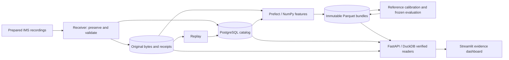

# Robot Component Health Monitor

A reproducible sensor-data pipeline and evidence dashboard for component condition monitoring. It preserves original measurements, builds versioned analytical datasets, and connects every reference-relative alert to its source recording.

The case study uses **IMS bearing experiment 2: 984 industrial test-rig recordings, four channels and 3,936 feature windows**. It demonstrates a data workflow relevant to robotics components. The measurements are from a bearing test rig; they are not robot telemetry.

## What it does

- Preserves original bytes and immutable receipts before transactional PostgreSQL projection; replay recovers interrupted projection without the source directory.
- Validates content hashes, file structure, finite measurements, timing and channel quality. Missing/unscorable observations remain explicit.
- Uses Prefect and NumPy to publish immutable Parquet features with frozen input, code, configuration and dependency identities.
- Fits reference-only median/MAD parameters, freezes the evaluation policy, and publishes evidence-linked scores and causal alert states.
- Serves bounded, checksum-verified reads through FastAPI and DuckDB to a Streamlit dashboard with trends, alert evidence, quality and source-signal previews.

## Architecture



Python 3.12 · PostgreSQL 17 · Alembic · Prefect · NumPy · PyArrow/Parquet · DuckDB · FastAPI/Pydantic · Streamlit/Altair · Docker Compose · pytest

Metadata belongs in PostgreSQL; original measurements and analytical files live in project-owned Docker volumes. The API mounts evidence read-only. The dashboard has no database credentials or data-volume mounts. [Architecture and boundaries](docs/architecture.md).

## Run locally

Requires Docker with Linux/amd64 containers and Compose. The verified host used Windows/PowerShell, four Docker CPUs and approximately 11.6 GiB available to Docker; no GPU or paid API is required. Other host/architecture combinations remain unverified.

```powershell
git clone https://github.com/utsav-chokshi/robot-component-health-monitor.git
cd robot-component-health-monitor
./scripts/Initialize-LocalEnvironment.ps1
docker compose up --build -d --wait dashboard
```

Open [the dashboard](http://localhost:8502) and [API documentation](http://localhost:8020/docs). An empty stack starts with an empty evaluation catalog. It does not download or process data automatically. `/healthz` checks process liveness; `/readyz` checks database migration/contracts and accessible storage, rather than dataset completeness or every stored checksum.

To populate the dashboard:

1. [Obtain, checksum-verify and manually extract IMS `2nd_test`](docs/ingestion.md#prepare-the-input-explicitly). The source archive and original documentation are excluded from this repository.
2. Follow the [complete reproduction guide](docs/reproduction.md): ingest → replay → Prefect features → reviewed development calibration → freeze policy → evaluate → verify rebuild.
3. Follow the [three-minute demo](docs/demo.md) to inspect trends, an alert and its verified source recording.

The initializer generates a private random database password and preserves an existing `.env`. Keep it out of Git and retain the matching credentials with existing volumes. API/dashboard ports bind to loopback; PostgreSQL is internal. Change `API_PORT`/`DASHBOARD_PORT` before startup if occupied. Linux/macOS users must create `.env` from `.env.example` and supply a random URL-safe password; that host path is unverified.

## Measured validation

Observed locally on 10 November 2026:

| Check | Result |
| --- | --- |
| Original measurements | 984 recordings; 544,618,480 bytes verified |
| Feature coverage | 3,936 / 3,936 windows eligible |
| Chronological split | 196 reference / 196 development / 592 evaluation recordings |
| Operational score coverage | 3,152 / 3,152 across development and evaluation |
| Automated checks | 67 core/API + 5 dashboard tests passed |
| Targeted forced stops | 4 recoveries passed; no duplicate build registrations |
| Fresh application-volume reproduction | Feature, development and evaluation manifests and final metrics matched the original |
| Prefect rebuild | Frozen output matched; sampled worker-container maximum 561.5 MiB under a 1-GiB limit |
| Integrity and outage | Corrupt/missing evidence rejected; database recovery required no API restart |

Fresh-volume validation reused prepared source, base images and dependency caches. Sampling can miss brief memory peaks. Fresh-host download/extraction, other architectures, exhaustive host-power-loss behavior and remote CI results remain unverified. [Verification scope](docs/validation.md) · [Frozen evaluation results and hashes](docs/evaluation-results.md) · [Machine-readable delivery summary](docs/evidence/verification-summary.json).

The evaluation produced four open-boundary reference-relative alert episodes, one per channel. These are observed signal excursions. The data does not provide reliable per-record healthy/fault-onset labels or exact failure timing, so detection accuracy, false-alarm rate, warning lead time, failure probability and remaining life are not established. Physical amplitude scaling and source timezone also remain unverified. [Metric definitions and interpretation](docs/evaluation.md).

## Tests and shutdown

```powershell
docker compose --profile test run --build --rm tests
docker compose --profile test run --build --rm --no-deps dashboard-tests
docker compose --profile test stop test-postgres
docker compose --profile '*' stop
```

Core tests use a separate temporary PostgreSQL service and unique test databases. Dashboard tests run independently. Stop preserves application evidence; removing volumes discards it. CI is configured in [GitHub Actions](.github/workflows/tests.yml), with remote results reported only after an observed run. [Development and locked environments](docs/development.md).

## Design decisions and future work

[The case study](docs/case-study.md) explains the engineering choices. [Future enhancements](docs/future-enhancements.md) cover a guarded investigation agent, better labeled/multi-component data, production authorization and broader host validation. The application runs independently of model inference; the agent is disabled pending a revised passing evaluation. No maintenance or robot action is exposed.

Original application code is [MIT licensed](LICENSE). The [dataset and dependencies retain their own attribution and terms](THIRD_PARTY.md). Raw data, original PDFs, archives, credentials, runtime databases and model weights are excluded.
